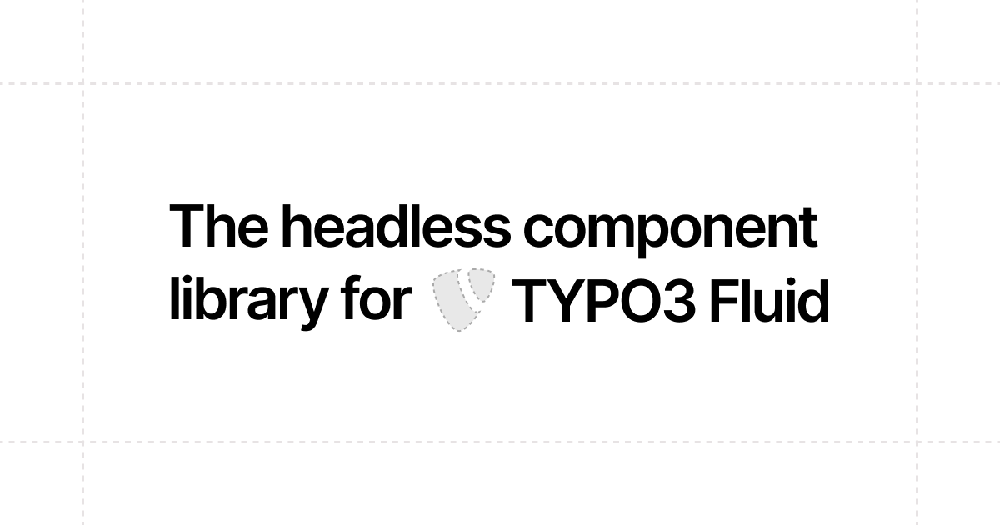

# Fluid Primitives

The headless component library for TYPO3 Fluid

## Documentation

The documentation can be found at [fluid-primitives.com](https://fluid-primitives.com).

## Development

Clone the repo with the fluid-primitives submodule, then run:

```bash
ddev start
ddev composer install
ddev snapshot restore --latest
ddev npm install
ddev npm run dev
```

Then open [https://fluid-primitives.ddev.site](https://fluid-primitives.ddev.site) in your browser.

## Environment

`config/system/settings.php` holds no secret and no value of one machine. They come from environment variables:

- `TYPO3__SECTION__key` sets `$GLOBALS['TYPO3_CONF_VARS']['SECTION']['key']`, `__` separates the levels. `TYPO3__DB__Connections__Default__host=db` sets `['DB']['Connections']['Default']['host']`. Whole numbers, decimals, `true`, `false` and `null` become that type, a password or key stays a string.
- `APP_URL` is the base URL of the site (`config/sites/main/config.yaml`), and the only host it answers to.
- `DISABLE_CACHES=true` turns the TYPO3 caches off for development.
- A variable always wins over a default of `config/system/additional.php`.

`.env.default` lists the values for development. `ddev start` copies it to `.env` when there is none, and [helhum/dotenv-connector](https://github.com/helhum/dotenv-connector) loads `.env` when Composer's autoloader starts, for the web and the console. A variable the process already has is not replaced by the file, and nothing is loaded when `APP_ENV` is set. A value with a `$` needs single quotes. `.env` is not committed and not copied into the image. If you had a `.env` before this file existed, append the lines of `.env.default` to it.

`TYPO3_CONTEXT` is read before any file, ddev sets it in `.ddev/config.yaml`.

## Deploy the docs site

The `Dockerfile` builds the image of fluid-primitives.com. It sets `APP_ENV=production`, so a `.env` file is never read, and `TYPO3_CONTEXT=Production`. In the Production context the site refuses to start and names the variable when one of these is missing, none of them is in the repository:

| Variable                                    | What it is                                                                                               |
| ------------------------------------------- | -------------------------------------------------------------------------------------------------------- |
| `APP_URL`                                   | The base URL, `https://fluid-primitives.com`. Its host is the only one the site answers to.              |
| `TYPO3__SYS__encryptionKey`                 | The encryption key, 96 random hex characters (`openssl rand -hex 48`). It signs form tokens and `cHash`. |
| `TYPO3__DB__Connections__Default__host`     | The database host.                                                                                       |
| `TYPO3__DB__Connections__Default__dbname`   | The database name.                                                                                       |
| `TYPO3__DB__Connections__Default__user`     | The database user.                                                                                       |
| `TYPO3__DB__Connections__Default__password` | The database password.                                                                                   |

Optional, and set the same way:

- `TYPO3__SYS__reverseProxyIP` and `TYPO3__SYS__reverseProxySSL` - the address or range of your reverse proxy. Without them a proxy of the private networks of a container setup is believed.
- `TYPO3__SYS__trustedHostsPattern` - a regular expression for the host header, instead of the host of `APP_URL`.
- `TYPO3__BE__installToolPassword` - the hash of the Install Tool password. Without it the Install Tool stays locked.
- `TYPO3__SYS__systemMaintainers` - the user ids of the system maintainers, comma separated.

## Playground

You can find a Playground page under `/playground` where you can test components and context code without modifying the example files.

## Storybook

Run Storybook with:

```bash
ddev npm run storybook
```

and open [fluid-primitives.ddev.site:8080](https://fluid-primitives.ddev.site:8080) in your browser.
